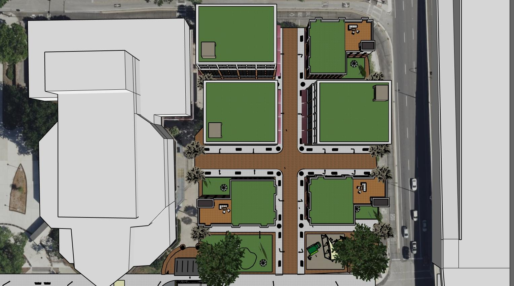

# SketchUp Sample

This page contains a final project that was completed for the University of Central Florida’s (UCF) “Urban Design (PAD 4334)” course. As reference, the primary goal of this final project was to create and present urban design solutions that could improve the social use of UCF Downtown. For Taylor’s portion of the final project, she chose to redesign the most underutilized portions of UCF Downtown, and the surrounding vicinity, into diverse mixed-use villages. To create and present these mixed-use villages, she utilized Trimble’s SketchUp program and Microsoft's PowerPoint program.

## Urban Design - Final Presentation

  <object data="./assets/SketchUp_Presentation.pdf" type="application/pdf" width="800px" height="500px">
    
This browser does not support PDFs. Please download the PDF to view it: <a href="./assets/SketchUp_Presentation.pdf">Download PDF</a>.

  </object>

## Mixed-Use Village 1, Top-Down 

  

## Mixed-Use Village 1, Street-View

  <object data="./assets/SketchUp_2.jpg" type="application/jpg" width="800px" height="500px">
    
This browser does not support JPGs. Please download the JPG to view it: <a href="./assets/SketchUp_2.jpg">Download JPG</a>.

  </object>

## Mixed-Use Village 2, Top-Down

  <object data="./assets/SketchUp_3.jpg" type="application/jpg" width="800px" height="500px">
    
This browser does not support JPGs. Please download the JPG to view it: <a href="./assets/SketchUp_3.jpg">Download JPG</a>.

  </object>

## Mixed-Use Village 2, Street-View

  <object data="./assets/SketchUp_4.jpg" type="application/jpg" width="800px" height="500px">
    
This browser does not support JPGs. Please download the JPG to view it: <a href="./assets/SketchUp_4.jpg">Download JPG</a>.

  </object>

